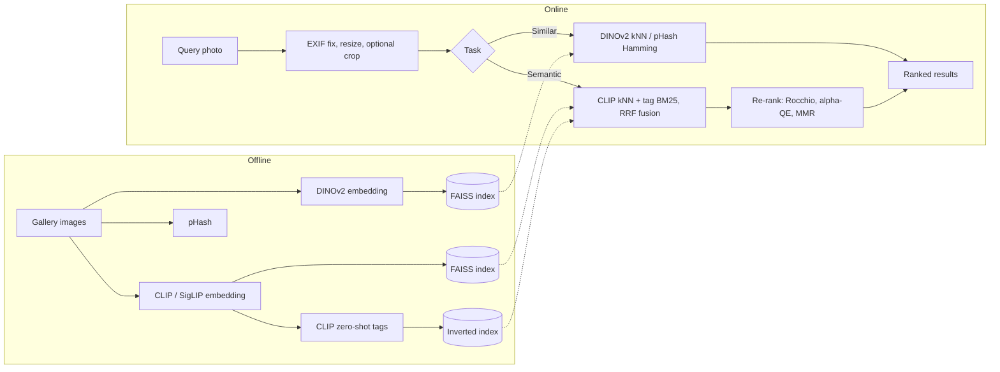

# Zero-Shot Image-to-Image Search

**English** | [繁體中文](README.zh-TW.md)

An image-to-image search engine built for an Information Retrieval course final project. You upload any photo you took yourself, and the system returns a ranked list from a gallery of about 40,000 everyday photos. It supports two tasks over the same gallery:

- **Semantic search.** Finds images of the *same kind of thing*. A photo of your cat returns other cats, even though your cat is not in the gallery.
- **Similar-image search.** Finds images that are *the same picture or scene*: cropped, recolored, compressed or re-photographed copies, and other shots of the same scene.

No model is trained or fine-tuned. Every component is pre-trained, so any photo can be used as a query (zero-shot).

> **Status:** in development (November 2026). Weeks 1–2 work: CLIP, DINOv2 and pHash embeddings, FAISS Flat search for both tasks, synthetic edits, CLIP zero-shot tags in an HW1-format inverted index with HW2 BM25, RRF fusion, the evaluation script, a Gradio demo and the photo-pair check (see *Getting started*). Feedback, MMR, ANN indexes and SigLIP are still planned.

## Why two tasks

The same query has different relevant results depending on the task. For a photo of a cat on a sofa, semantic search counts every cat as relevant, while similar-image search counts only copies of that photo. The project's core question is:

> **Which image representation suits which retrieval task?**

Both tasks share one gallery, one indexing layer and one evaluation framework. Only the representation and the definition of relevance change.

## How it works



| Component | Choice | Notes |
|---|---|---|
| Semantic representation | CLIP (OpenCLIP ViT-B/32), SigLIP | Trained with text supervision, so similarity follows human category concepts; SigLIP is a second semantic model to compare against CLIP |
| Visual representation | DINOv2 | Image-only self-supervised features, sensitive to appearance and layout |
| Classic baseline | pHash (64-bit) | Perceptual hash compared by Hamming distance; handles light edits only |
| Sparse line | CLIP zero-shot tags → inverted index → BM25 | Top-15 concept tags per image act as a "document". Labels come from fixed external class lists (COCO, Open Images, Places), not learned from the gallery |
| Fusion | Reciprocal Rank Fusion | Combines dense and sparse rankings; shared tags explain why a result matched |
| Feedback | Rocchio (user-marked), alpha-QE (automatic) | Rocchio moves the query vector toward marked results; alpha-QE is pseudo-relevance feedback |
| Diversity | MMR | Covers different readings of an ambiguous query ("the cat or the sofa?") |
| Indexing | FAISS Flat, cluster pruning (≈ IVF), IVF-PQ, HNSW | Measured for recall loss, latency and index size; IVF-PQ adds vector compression |

## Datasets

Both tasks share the main gallery:

- **Gallery:** a 40,000-image subset of MS-COCO train2017.
- **Semantic queries:** 1,000 val2017 images, none of which are in the gallery. Graded relevance is the share of COCO object categories a result has in common with the query.
- **Similar queries:**
  - 1,000 gallery images with synthetic edits (crop, rotation, color shift, JPEG, blur). The ground truth is the original image.
  - INRIA Holidays photos merged into the gallery, for real same-scene matches.
- **User study:** about 100 phone photos, judged by pooling (see Evaluation).
- **External benchmark (supplementary):** [ROxford5k / RParis6k](https://github.com/filipradenovic/revisitop) under the official revisitop protocol, for the similar-image task only. They are not merged into the shared gallery; they let the similar-image results be compared with published work.

Candidate open datasets, ranked by fit for this project (availability checked 2026-11-18):

| # | Dataset | Size | Labels | Tasks | Access / license |
|---|---|---|---|---|---|
| 1 | [MS-COCO 2017](https://cocodataset.org/) ([HF mirror](https://huggingface.co/datasets/detection-datasets/coco)) | train 117k, val 4.95k | 80 object classes, multi-label | Semantic + similar (synthetic) | Direct download; annotations CC BY 4.0 |
| 2 | [Open Images V7](https://storage.googleapis.com/openimages/web/download_v7.html) (subset) | val 41,620 (full 9.18M) | 20,638 image-level classes | Semantic + similar (synthetic) | `downloader.py` or FiftyOne; images mostly CC BY 2.0 |
| 3 | [Unsplash Lite](https://github.com/unsplash/datasets) | ~25k | Keywords only | Demo; similar (synthetic) | ~700 MB; commercial and non-commercial use, no redistribution of images |
| 4 | [INRIA Holidays](https://thoth.inrialpes.fr/~jegou/data.php.html) | 1,491 images, 500 queries | Same-scene groups | Similar (real) | FTP links listed; not yet tested |
| 5 | [INRIA Copydays](https://thoth.inrialpes.fr/~jegou/data.php.html) | Originals + crop/JPEG/strong attacks | Copy pairs | Similar (real edits) | HTTP archives listed |
| 6 | [Caltech-256](https://data.caltech.edu/records/nyy15-4j048) | 30,607 images | 256 classes, single-label | Semantic + similar (synthetic) | 1.2 GB direct download; CC BY 4.0 |
| 7 | [Places365](https://github.com/CSAILVision/places365) | 365 scene classes | Scene labels | Semantic (scenes) | Tarball on data.csail.mit.edu; main site unreachable when checked |
| 8 | [Flickr30k](https://huggingface.co/datasets/nlphuji/flickr30k) (HF mirror) | 31,014 images | 5 captions each, no classes | Semantic (caption-derived) | 4.4 GB; non-commercial research |
| 9 | [California-ND](https://sites.google.com/site/vonikakis/datasets) | 701 personal photos | Near-duplicate probabilities from 10 annotators | Similar (real) | Encrypted zip, password by email |
| 10 | [DISC21](https://ai.meta.com/datasets/disc21-dataset/) | 1M references + 50k queries | Copy pairs | Similar (real edits) | ~350 GB; license not stated on page |

## Evaluation

Runs are written in TREC format and scored with `trec_eval`.

| Task | Metrics |
|---|---|
| Semantic search | nDCG@10, mAP (graded relevance from shared COCO categories) |
| Similar-image search | Recall@1, Recall@10, MRR, reported per edit type |
| Phone-photo queries | Pool the top 10 of every system; two annotators grade 0/1/2; nDCG@10 and Cohen's kappa |
| Efficiency | Median latency per stage (embedding, search, re-rank), index size, ANN recall loss against Flat. Search is always timed on CPU so that HNSW, which FAISS runs only on CPU, is compared fairly |
| Per-query diagnostics | AP for every query and configuration; a hard-query list sorted by AP, used for failure analysis and shown in the demo |

**Planned experiments**

1. A cross table of 4 representations (CLIP, SigLIP, DINOv2, pHash) × 2 tasks.
2. Semantic ablation: CLIP only, tag BM25 only, RRF fusion, then fusion with alpha-QE and with MMR.
3. Robustness of DINOv2 against pHash for each edit type.
4. Flat vs. cluster pruning vs. IVF-PQ vs. HNSW.
5. Supplementary: the similar-image task on ROxford/RParis (Easy / Medium / Hard mAP).

**Current results** (2,000-image gallery, 200 semantic queries; `results/summary.csv`)

| Semantic | nDCG@10 | mAP |
|---|---|---|
| CLIP kNN | 0.652 | 0.236 |
| DINOv2 kNN | 0.684 | 0.274 |
| Tag BM25 | 0.656 | 0.279 |
| RRF fusion (CLIP + tags) | 0.676 | 0.277 |
| Tag BM25, no COCO labels | 0.653 | 0.276 |
| RRF fusion, no COCO labels | 0.675 | 0.275 |

**Photo pairs** (`scripts/06_pairs.py`, `results/pairs.csv`). 10 synthetic pairs for now (a COCO val image joins the gallery; its crop 0.6 + rotation + color + JPEG edit is the query). Partner at rank 1 / in the top 10: CLIP 9/10 · 10/10, DINOv2 9/10 · 10/10, fusion 7/10 · 10/10, tag BM25 4/10 · 7/10, pHash 0/10 · 0/10. Real phone-photo pairs go in `data/pairs/<name>/` and run the same way.

**Leakage note.** The semantic ground truth comes from COCO categories, so having the 80 COCO class names in the tag vocabulary gives the tag line a head start. The `_nococo` rows drop every term that comes only from COCO and re-tag the gallery over the smaller vocabulary (971 → 955 terms). Only 16 of the 80 COCO names go; the other 64 survive word for word through Open Images or Places365. So the ablation removes only a small part of the head start, and the small gap it shows (tags nDCG@10 0.656 → 0.653) is a lower bound on the leakage, not a measure of it.

## Planned project layout

```
.
├── configs/default.yaml      # models, K, fusion and feedback weights, index parameters
├── data/                     # [not in git] datasets
├── cache/                    # [not in git] embeddings, hashes, tags, indexes
├── src/
│   ├── encoders.py           # CLIP / DINOv2 / pHash behind one interface
│   ├── tagging.py            # CLIP zero-shot tags over a fixed label vocabulary
│   ├── sparse/               # inverted index + BM25 (reused from HW1/HW2)
│   ├── index.py              # FAISS Flat / HNSW, cluster pruning
│   ├── rerank.py             # RRF, Rocchio, alpha-QE, MMR
│   ├── edits.py              # synthetic edits for similar-image queries
│   ├── schema.py             # SearchRequest / SearchResult, agreed by both members
│   └── pipeline.py           # online search, shared by evaluation and demo
├── scripts/                  # numbered offline steps: download, embed, tag, index, evaluate
├── app/                      # web demo
└── results/
    ├── summary.csv           # metrics, staged latency, index size, recall loss per configuration
    ├── per_query/            # AP per query per configuration; source of the hard-query list
    └── runs/                 # TREC runs and trec_eval output
```

### Engineering conventions

- All parameters (models, K, fusion and feedback weights, index settings) live in `configs/default.yaml`, never hard-coded.
- Evaluation scripts and the demo call the same `src/pipeline.py`, so the demo shows exactly what was evaluated.
- `src/schema.py` fixes the data passed between the two members' modules.
- Latency is recorded in three stages, with search always on CPU.

## Getting started

Working now (Weeks 1–2). The default config runs on a small slice: 2,000 gallery images, 200 semantic queries, 200 similar queries. Raise `data.*` in `configs/default.yaml` toward 40,000 / 1,000 / 1,000 to scale up.

```bash
python -m venv .venv && .venv/Scripts/activate   # Windows; use .venv/bin/activate elsewhere
pip install -r requirements.txt
curl -o data/annotations_trainval2017.zip http://images.cocodataset.org/annotations/annotations_trainval2017.zip
python scripts/01_download.py          # picks the subset, fetches only those images, writes manifests
python scripts/02_embed.py --models clip dinov2 phash
python scripts/03_tag.py              # CLIP zero-shot tags -> cache/tags*/ (HW1 postings format)
python scripts/04_build_index.py --index flat
python scripts/05_evaluate.py          # results/summary.csv, results/per_query/, results/runs/
python scripts/06_pairs.py             # photo-pair check -> results/pairs.csv
python scripts/search.py my_photo.jpg --task semantic   # or --task similar
python app/app.py                      # web demo on http://127.0.0.1:7860
python -m pytest -m "not models"       # fast tests; drop -m to include the real-model tests
```

To re-score the TREC runs with `trec_eval`, pass `-l 2` (grades ≥ 2 are exactly the images counted as relevant for mAP), e.g. `trec_eval -l 2 -m map -m ndcg_cut.10 results/runs/semantic.qrels results/runs/semantic_clip.run`. trec_eval's nDCG uses the integer grades 0–3, so it differs slightly from the float-gain nDCG in `summary.csv`.

Still planned: `--index cluster ivfpq hnsw`, SigLIP, Rocchio feedback, alpha-QE and MMR.

A GPU is needed only for embedding. Search and the demo run on CPU.

### Running from the zip

`python scripts/makezip.py` packs the project into `dist/ir_image_search-<date>.zip` (about 400 MB). The zip holds the code, the 2,000 gallery images, the val images, the manifests, the label lists, the photo pairs, the embedding/tag caches and the per-query results, so nothing has to be downloaded or re-embedded. `--code-only` packs just the git files instead. Not included: `.venv`, demo photos in `data/user/`, and `instances_train2017.json`, which only `01_download.py` needs.

On the receiving PC (Python 3.12 or newer):

```bash
cd ir_image_search
python -m venv .venv && .venv/Scripts/activate   # Windows; use .venv/bin/activate elsewhere
pip install -r requirements.txt
python -m pytest -m "not models"       # should all pass
python app/app.py                      # demo on http://127.0.0.1:7860
python scripts/05_evaluate.py          # reproduces results/summary.csv
```

The first search downloads the CLIP and DINOv2 weights from Hugging Face (about 700 MB, once). To rerun `01_download.py`, first fetch the annotations zip as in *Getting started*.

## Demo

- Upload a photo, optionally crop it, and switch between **Semantic** and **Similar** search.
- Results appear as a thumbnail grid. Semantic results show the tags they share with the query.
- Mark results as relevant to re-run the query with Rocchio feedback.
- A **hard queries** panel lists the evaluation queries with the lowest AP, for inspecting failures.

## Roadmap

- [ ] Week 1: download COCO; CLIP and DINOv2 embeddings, pHash, FAISS Flat; both tasks searchable from a script
- [ ] Week 2: CLIP tags into the inverted index, BM25, RRF fusion; synthetic edit queries; web demo
- [ ] Week 3: Rocchio, alpha-QE, MMR; cluster pruning, IVF-PQ and HNSW; evaluation scripts; phone photos and judging
- [ ] Week 4: full experiments, ROxford/RParis supplementary run, hard-query failure analysis, report and demo

If time runs short, the ROxford/RParis run, HNSW and MMR are cut first. Dense retrieval for both tasks and its evaluation always ship.

## Team

| Member | Responsibilities |
|---|---|
| 陳長壻 | Semantic search: CLIP tags, inverted index and BM25 over tags, RRF fusion, Rocchio and alpha-QE, MMR; semantic evaluation |
| 鄧存正 | Similar-image search: DINOv2 and pHash, synthetic edits; FAISS and cluster pruning; web demo; similarity and efficiency evaluation |

Shared: data preprocessing, `src/pipeline.py` and `src/schema.py`, phone-photo judging, final report.

## Acknowledgements

- [ImgSearch](https://github.com/seamile/ImgSearch), the reference project, which showed that CLIP embeddings plus nearest-neighbor search work on a single machine.
- [OpenCLIP](https://github.com/mlfoundations/open_clip), [DINOv2](https://github.com/facebookresearch/dinov2), [FAISS](https://github.com/facebookresearch/faiss), [ImageHash](https://github.com/JohannesBuchner/imagehash).
- Ranking, inexact top-k and evaluation methods follow Manning, Raghavan and Schütze, *Introduction to Information Retrieval*.

## License

To be decided. Datasets keep their own licenses (see the table above); the images are not redistributed in this repository.
