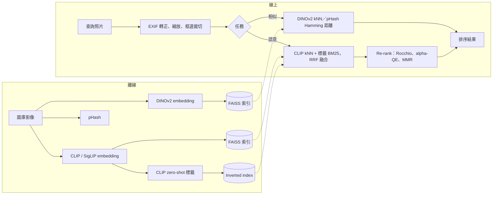

# Zero-Shot 以圖搜圖引擎

[English](README.md) | **繁體中文**

這是資訊檢索課程的期末專題：一個純以圖搜圖的引擎。使用者上傳任意一張自己拍的照片，系統從約 4 萬張日常照片的圖庫中回傳排序結果。同一個圖庫支援兩種任務：

- **語意搜尋：** 找「同一類」的影像。拿自家的貓去查，會回傳圖庫裡其他的貓，即使圖庫裡沒有這隻貓。
- **相似影像搜尋：** 找「看起來是同一張」的影像。包括被裁切、調色、壓縮或翻拍的版本，以及同一場景的其他照片。

系統不訓練、不 fine-tune 任何模型，所有元件都是預訓練的，任何照片都能直接查詢（zero-shot）。

> **狀態：** 開發中（2026 年 11 月）。第一、二週的部分已經可以跑：CLIP、DINOv2、pHash 特徵，兩種任務的 FAISS Flat 檢索、合成編輯，CLIP zero-shot 標籤建成 HW1 格式的倒排索引並用 HW2 的 BM25 計分、RRF 融合、評估腳本、Gradio demo 和照片配對檢查（見「快速開始」）。回饋、MMR、ANN 索引和 SigLIP 還在規劃中。

## 為什麼分兩個任務

同一張 query 在不同任務下，相關的結果不一樣。以一張「貓在沙發上」的照片為例，語意搜尋認為所有的貓都相關，相似影像搜尋則只認這張照片的副本。本專題的核心問題是：

> **哪一種影像表示適合哪一種檢索任務？**

兩個任務共用同一個圖庫、同一套索引和同一套評估框架，只替換影像表示和相關性的定義。

## 系統架構



| 元件 | 選擇 | 說明 |
|---|---|---|
| 語意表示 | CLIP（OpenCLIP ViT-B/32）、SigLIP | 以文字監督訓練，相似度接近人的類別概念；SigLIP 作為第二個語意模型，和 CLIP 比較 |
| 外觀表示 | DINOv2 | 只用影像自監督學習，對外觀和構圖敏感 |
| 經典基準 | pHash（64 位元） | 感知雜湊，以 Hamming 距離比對，只能處理輕微編輯 |
| Sparse 線 | CLIP zero-shot 標籤 → inverted index → BM25 | 每張圖取前 15 個概念標籤當作「文件」。詞表取自外部固定的類別名稱（COCO、Open Images、Places），不從圖庫學習 |
| 融合 | Reciprocal Rank Fusion | 合併 dense 和 sparse 的排序；共同標籤可以解釋結果為什麼相關 |
| 回饋 | Rocchio（使用者勾選）、alpha-QE（自動） | Rocchio 把 query 向量移向勾選的結果；alpha-QE 是 pseudo-relevance feedback |
| 多樣性 | MMR | 意圖不明確時（要找貓還是沙發？），讓前幾名涵蓋不同解讀 |
| 索引 | FAISS Flat、cluster pruning（≈ IVF）、IVF-PQ、HNSW | 量測 recall 損失、延遲和索引大小；IVF-PQ 多了向量壓縮 |

## 資料集

兩個任務共用主圖庫：

- **圖庫：** MS-COCO train2017 的 4 萬張子集。
- **語意 query：** val2017 的 1,000 張，都不在圖庫中。結果和 query 共有的 COCO 物體類別比例越高，相關程度越高（分級相關性）。
- **相似 query：**
  - 從圖庫抽 1,000 張，自動加上裁切、旋轉、調色、JPEG、模糊等編輯，正確答案就是原圖。
  - 併入 INRIA Holidays，提供真實的同場景照片。
- **人工評估：** 約 100 張手機照片，以 pooling 評分（見「評估」）。
- **外部 benchmark（補充實驗）：** [ROxford5k／RParis6k](https://github.com/filipradenovic/revisitop)，依 revisitop 官方協定評估，只用於相似影像任務。它們不併入共用圖庫，用途是讓相似任務的結果能和文獻對照。

候選的開源資料集，依本專題的適合度排序（2026-11-18 確認可取得）：

| # | 資料集 | 規模 | 標註 | 適用任務 | 取得方式／授權 |
|---|---|---|---|---|---|
| 1 | [MS-COCO 2017](https://cocodataset.org/)（[HF 鏡像](https://huggingface.co/datasets/detection-datasets/coco)） | train 117k、val 4.95k | 80 類物體，多標籤 | 語意 + 相似（合成編輯） | 直接下載；標註為 CC BY 4.0 |
| 2 | [Open Images V7](https://storage.googleapis.com/openimages/web/download_v7.html)（子集） | val 41,620 張（全集 9.18M） | 20,638 類 image-level labels | 語意 + 相似（合成編輯） | `downloader.py` 或 FiftyOne；圖片多為 CC BY 2.0 |
| 3 | [Unsplash Lite](https://github.com/unsplash/datasets) | 約 25k | 只有關鍵字 | Demo；相似（合成編輯） | 約 700 MB；商用與非商用皆可，但不可重新散佈圖片 |
| 4 | [INRIA Holidays](https://thoth.inrialpes.fr/~jegou/data.php.html) | 1,491 張，500 個 query | 同場景分組 | 相似（真實） | 頁面列有 FTP 連結，尚未實測 |
| 5 | [INRIA Copydays](https://thoth.inrialpes.fr/~jegou/data.php.html) | 原圖 + 裁切／JPEG／強攻擊版 | 副本對應 | 相似（真實編輯） | 頁面列有 HTTP 壓縮檔 |
| 6 | [Caltech-256](https://data.caltech.edu/records/nyy15-4j048) | 30,607 張 | 256 類，單標籤 | 語意 + 相似（合成編輯） | 1.2 GB 直接下載；CC BY 4.0 |
| 7 | [Places365](https://github.com/CSAILVision/places365) | 365 類場景 | 場景標籤 | 語意（場景） | tar 檔放在 data.csail.mit.edu；確認時主站連線失敗 |
| 8 | [Flickr30k](https://huggingface.co/datasets/nlphuji/flickr30k)（HF 鏡像） | 31,014 張 | 每張 5 句 caption，無類別 | 語意（需從 caption 推相關性） | 4.4 GB；限非商業研究 |
| 9 | [California-ND](https://sites.google.com/site/vonikakis/datasets) | 701 張個人照片 | 10 位標註者給的近似重複機率 | 相似（真實） | 壓縮檔加密，需 email 索取密碼 |
| 10 | [DISC21](https://ai.meta.com/datasets/disc21-dataset/) | 1M 參考圖 + 50k query | 副本對應 | 相似（真實編輯） | 約 350 GB；頁面未寫授權 |

## 評估

結果以 TREC 格式輸出，用 `trec_eval` 評分。

| 任務 | 指標 |
|---|---|
| 語意搜尋 | nDCG@10、mAP（以共同 COCO 類別定義分級相關性） |
| 相似影像搜尋 | Recall@1、Recall@10、MRR，依編輯類型分開報告 |
| 手機照片 query | 每個系統取前 10 名合併成 pool，兩位標註者各給 0/1/2 分；計算 nDCG@10 和 Cohen's kappa |
| 效率 | 分 embedding、搜尋、re-rank 三段的延遲中位數，索引大小，ANN 相對於 Flat 的 recall 損失。搜尋一律在 CPU 上量，因為 FAISS 的 HNSW 只支援 CPU，這樣比較才公平 |
| 逐 query 診斷 | 記錄每個 query 在每組設定下的 AP；依 AP 由低到高列出困難 query，用於錯誤分析並顯示在 demo 中 |

**規劃中的實驗**

1. 4 種表示（CLIP、SigLIP、DINOv2、pHash）× 2 個任務的交叉表。
2. 語意任務的消融實驗：只用 CLIP、只用標籤 BM25、RRF 融合，再分別加上 alpha-QE 和 MMR。
3. 依編輯類型比較 DINOv2 和 pHash 的強健度。
4. Flat、cluster pruning、IVF-PQ、HNSW 的比較。
5. 補充實驗：相似影像任務在 ROxford／RParis 上的表現（Easy／Medium／Hard mAP）。

**目前結果**（圖庫 2,000 張、語意查詢 200 張；`results/summary.csv`）

| 語意任務 | nDCG@10 | mAP |
|---|---|---|
| CLIP kNN | 0.652 | 0.236 |
| DINOv2 kNN | 0.684 | 0.274 |
| 標籤 BM25 | 0.656 | 0.279 |
| RRF 融合（CLIP＋標籤） | 0.676 | 0.277 |
| 標籤 BM25，不含 COCO 標籤 | 0.653 | 0.276 |
| RRF 融合，不含 COCO 標籤 | 0.675 | 0.275 |

**照片配對**（`scripts/06_pairs.py`、`results/pairs.csv`）。目前先用 10 組合成配對（COCO val 的原圖加進圖庫，經過裁切 0.6＋旋轉＋調色＋JPEG 壓縮的版本當查詢）。配對的另一張排第 1／進前 10 的組數：CLIP 9/10、10/10，DINOv2 9/10、10/10，融合 7/10、10/10，標籤 BM25 4/10、7/10，pHash 0/10、0/10。之後真的用手機拍的配對放到 `data/pairs/<名稱>/`，跑法一樣。

**資料洩漏說明。** 語意任務的正確答案來自 COCO 類別，所以標籤詞彙裡有 COCO 的 80 個類別名稱，會讓標籤這條線占便宜。`_nococo` 那幾列拿掉了只出現在 COCO 的詞，並用較小的詞彙重新幫圖庫貼標籤（971 → 955 個詞）。80 個 COCO 類別名稱裡只拿掉了 16 個，其餘 64 個在 Open Images 或 Places365 裡有一模一樣的詞，所以都還在。這個消融實驗只拿掉了一小部分優勢，它顯示的小差距（標籤 nDCG@10 0.656 → 0.653）只是洩漏程度的下限，不能當成洩漏的大小。

## 規劃中的目錄結構

```
.
├── configs/default.yaml      # 模型、K、融合與回饋權重、索引參數
├── data/                     # [不進 git] 資料集
├── cache/                    # [不進 git] embedding、雜湊、標籤、索引
├── src/
│   ├── encoders.py           # CLIP／DINOv2／pHash 的統一介面
│   ├── tagging.py            # 以固定詞表做 CLIP zero-shot 標籤
│   ├── sparse/               # inverted index + BM25（重用 HW1/HW2）
│   ├── index.py              # FAISS Flat／HNSW、cluster pruning
│   ├── rerank.py             # RRF、Rocchio、alpha-QE、MMR
│   ├── edits.py              # 產生相似任務的合成編輯 query
│   ├── schema.py             # SearchRequest／SearchResult，兩位組員共同定義
│   └── pipeline.py           # 線上檢索流程，評估與 demo 共用
├── scripts/                  # 依編號執行的離線步驟：下載、embedding、標籤、索引、評估
├── app/                      # 網頁 demo
└── results/
    ├── summary.csv           # 每組設定的指標、分段延遲、索引大小、recall 損失
    ├── per_query/            # 每組設定下每個 query 的 AP，是困難 query 清單的來源
    └── runs/                 # TREC run 與 trec_eval 輸出
```

### 工程規範

- 所有參數（模型、K、融合與回饋權重、索引設定）都寫在 `configs/default.yaml`，不寫死在程式裡。
- 評估腳本和 demo 呼叫同一份 `src/pipeline.py`，確保 demo 呈現的就是評估過的結果。
- `src/schema.py` 固定兩位組員模組之間傳遞的資料格式。
- 延遲分三段記錄，搜尋一律在 CPU 上量。

## 快速開始

目前可以執行的是第一、二週的部分。預設設定只跑一小部分資料：圖庫 2,000 張、語意查詢 200 張、相似查詢 200 張。要放大規模，把 `configs/default.yaml` 裡的 `data.*` 調到 40,000／1,000／1,000。

```bash
python -m venv .venv && .venv/Scripts/activate   # Windows；其他系統用 .venv/bin/activate
pip install -r requirements.txt
curl -o data/annotations_trainval2017.zip http://images.cocodataset.org/annotations/annotations_trainval2017.zip
python scripts/01_download.py          # 抽樣、只下載抽到的圖、寫出 manifest
python scripts/02_embed.py --models clip dinov2 phash
python scripts/03_tag.py              # CLIP zero-shot 標籤 -> cache/tags*/（HW1 postings 格式）
python scripts/04_build_index.py --index flat
python scripts/05_evaluate.py          # 輸出 results/summary.csv、results/per_query/、results/runs/
python scripts/06_pairs.py             # 照片配對檢查 -> results/pairs.csv
python scripts/search.py my_photo.jpg --task semantic   # 或 --task similar
python app/app.py                      # 網頁 demo，開 http://127.0.0.1:7860
python -m pytest -m "not models"       # 快速測試；拿掉 -m 會連真實模型一起測
```

要用 `trec_eval` 重新計分 TREC run，請加 `-l 2`（等級 ≥ 2 的圖就是 mAP 算作相關的那些），例如 `trec_eval -l 2 -m map -m ndcg_cut.10 results/runs/semantic.qrels results/runs/semantic_clip.run`。trec_eval 的 nDCG 用的是 0–3 的整數等級，所以和 `summary.csv` 裡用小數增益算出的 nDCG 會有些微差距。

還沒做的：`--index cluster ivfpq hnsw`、SigLIP、Rocchio 回饋、alpha-QE 和 MMR。

只有抽 embedding 需要 GPU，檢索和 demo 都可以在 CPU 上執行。

### 用壓縮檔在別台電腦執行

`python scripts/makezip.py` 會把專案打包成 `dist/ir_image_search-<日期>.zip`（約 400 MB）。裡面有程式碼、圖庫的 2,000 張圖、val 圖、manifest、標籤清單、照片配對、embedding 與標籤的快取，以及每個查詢的結果，所以拿到的人不用重新下載或重抽 embedding。加 `--code-only` 則只打包 git 裡的檔案。不會打包的有：`.venv`、`data/user/` 裡從 demo 加進去的照片，以及 `instances_train2017.json`（只有 `01_download.py` 用得到）。

拿到壓縮檔的電腦（Python 3.12 以上）：

```bash
cd ir_image_search
python -m venv .venv && .venv/Scripts/activate   # Windows；其他系統用 .venv/bin/activate
pip install -r requirements.txt
python -m pytest -m "not models"       # 應該全部通過
python app/app.py                      # demo，開 http://127.0.0.1:7860
python scripts/05_evaluate.py          # 重現 results/summary.csv
```

第一次搜尋時會從 Hugging Face 下載 CLIP 和 DINOv2 的權重（約 700 MB，只需一次）。如果要重跑 `01_download.py`，先照「快速開始」下載 annotations 壓縮檔。

## Demo

- 上傳照片，可以框選要查詢的區域，並在**語意**和**相似**兩種搜尋之間切換。
- 結果以縮圖格狀顯示；語意搜尋的結果會標出和 query 共同的標籤。
- 勾選相關的結果後，系統會以 Rocchio 回饋重新查詢。
- **困難 query** 面板列出評估中 AP 最低的 query，方便檢視失敗原因。

## 時程

- [ ] 第 1 週：下載 COCO；CLIP 與 DINOv2 embedding、pHash、FAISS Flat；兩個任務都能從 script 查詢
- [ ] 第 2 週：CLIP 標籤進 inverted index、BM25、RRF 融合；產生合成編輯 query；網頁 demo
- [ ] 第 3 週：Rocchio、alpha-QE、MMR；cluster pruning、IVF-PQ 和 HNSW；評估腳本；拍照與人工評分
- [ ] 第 4 週：跑完整實驗與 ROxford／RParis 補充實驗、以困難 query 做錯誤分析、完成報告與 demo

時間不夠時，先拿掉 ROxford／RParis 補充實驗、HNSW 和 MMR。兩個任務的 dense 檢索與評估一定完成。

## 團隊

| 組員 | 負責項目 |
|---|---|
| 陳長壻 | 語意搜尋：CLIP 標籤、標籤的 inverted index 與 BM25、RRF 融合、Rocchio 與 alpha-QE、MMR；語意任務的評估 |
| 鄧存正 | 相似影像搜尋：DINOv2 與 pHash、合成編輯；FAISS 與 cluster pruning；網頁 demo；相似任務與效率的評估 |

共同負責：資料前處理、`src/pipeline.py` 與 `src/schema.py`、手機照片的人工評分、期末報告。

## 致謝

- [ImgSearch](https://github.com/seamile/ImgSearch)：本專題的參考專案，證明了 CLIP embedding 加最近鄰搜尋可以在單機上運作。
- [OpenCLIP](https://github.com/mlfoundations/open_clip)、[DINOv2](https://github.com/facebookresearch/dinov2)、[FAISS](https://github.com/facebookresearch/faiss)、[ImageHash](https://github.com/JohannesBuchner/imagehash)。
- 排序、inexact top-k 與評估方法參考 Manning、Raghavan、Schütze 的 *Introduction to Information Retrieval*。

## 授權

尚未決定。各資料集沿用其原本的授權（見上方資料集表），本 repo 不重新散佈任何圖片。
